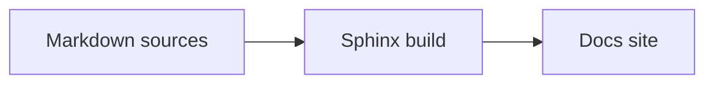

# Diagrams, animations, video, and alt text

## Diagrams
**Prefer diagrams as code.** This is added guidance. A text-defined diagram lives in the
repo, shows up in diffs, and is easy to update. [Mermaid](https://mermaid.js.org/) renders
natively in GitHub and GitLab Markdown, and in Sphinx via `sphinxcontrib-mermaid`.

````markdown

````

Other options (linked): [PlantUML](https://plantuml.com/), [D2](https://d2lang.com/),
[Graphviz](https://graphviz.org/), or exported SVG from a drawing tool with the source
file committed next to it.

Design checklist:
- [ ] One idea per diagram, with a title or caption stating it.
- [ ] Labels are readable at the page's width, and nothing needs zooming.
- [ ] Meaning doesn't rely on color alone. Use labels, shapes, or line styles too.
- [ ] It works in both light and dark mode (transparent backgrounds may vanish).
- [ ] A text equivalent follows, such as alt text or a short paragraph listing the steps
      or relationships.

### Inclusive diagrams
- When diagrams use emoji or characters to stand for people, choose representations
  thoughtfully, including skin tone and gender. Simple abstract figures avoid representing
  particular groups, at some cost to engagement.
- Check other visuals too, such as org charts, team pages, and marketing material.
- Where people are shown, consider letting them choose their own representation.
- Approach the topic with empathy. When unsure, ask your organization's DEI or HR team.

## Animated GIFs and video
- **Flashing or blinking content is a major accessibility problem,** especially when
  readers can't pause it.
- Looping GIFs confuse readers, because it's hard to tell where the sequence starts.
  Autoplay and looping take control away from readers, who want to set their own pace.
- **Prefer short videos (MP4 or WebM) with playback controls** to GIFs. GIFs can be
  converted.
- If you must use a GIF without controls, keep it very short (about five seconds), with
  no flashing and a clear purpose. Or show a static image and let readers choose to play
  the animation.
- Check whether your docs platform can turn off autoplay or add controls.
- Every animation and video needs alt text or captions, plus a transcript for narrated video.

## Alt text
- **Describe the purpose and context,** meaning what the reader should get from the image
  in that place, rather than every detail.
- **Keep it brief:** one or two sentences.
- **Don't just copy the caption.** It meets the minimum, but a considered description is better.
- **Leave out decoration** and text that already appears on the page.
- **Don't start with "Image of".** Screen readers already announce images. "Screenshot of"
  or "Graph of" is fine when it adds meaning.
- **Test it aloud:** imagine describing the image over the phone to someone who can't see it.
- For compliance questions, use [W3C WAI images guidance](https://www.w3.org/WAI/tutorials/images/) and WCAG.

| Weak | Better |
|---|---|
| `alt="image of settings"` | `alt="Settings page with the API keys panel open and the Create key button highlighted"` |
| `alt="diagram"` | `alt="Markdown sources flow into the Sphinx build, which publishes the docs site"` |

---

*Adapted from "Inclusiveness in diagrams" in the [Write the Docs newsletter, February 2023](https://www.writethedocs.org/blog/newsletter-february-2023/) (source: [`docs/blog/newsletter-february-2023.rst`](https://github.com/writethedocs/www/blob/c37669d0c87740b1455821cbee7fc10c8ee6cf7f/docs/blog/newsletter-february-2023.rst)), "To autoplay animated GIFs or not" in the [newsletter, July 2025](https://www.writethedocs.org/blog/newsletter-july-2025/) (source: [`docs/blog/newsletter-july-2025.rst`](https://github.com/writethedocs/www/blob/c37669d0c87740b1455821cbee7fc10c8ee6cf7f/docs/blog/newsletter-july-2025.rst)), and "Style guidance for alt text" in the [newsletter, February 2026](https://www.writethedocs.org/blog/newsletter-february-2026/) (source: [`docs/blog/newsletter-february-2026.rst`](https://github.com/writethedocs/www/blob/c37669d0c87740b1455821cbee7fc10c8ee6cf7f/docs/blog/newsletter-february-2026.rst)), © Write the Docs contributors, licensed [CC BY-NC-SA 4.0](https://creativecommons.org/licenses/by-nc-sa/4.0/). Changes: condensed and merged into checklists. The diagrams-as-code guidance and the examples are original work by Yuming Fu, 2026.*
